# 개발 워크스테이션 구축 과제

## 디렉토리 구조
dev-workstation-assignment/
├── README.md
├── screenshots/
└── dockerfile-practice/
    ├── Dockerfile
    └── site/
        └── index.html
└── site/
    └── index.html

- README.md: 과제 수행 과정과 결과를 정리한 문서
- screenshots/: README에 넣은 실습 캡처 이미지를 모아둔 폴더
- dockerfile-practice/: Dockerfile 실습 파일을 모아둔 폴더
- site/: Dockerfile 실습을 위해 위해 만든 폴더

## 1. 과제 개요
- 과제 목적: 개발 워크스테이션 구축 및 CLI, docker, git/github 사용 경험에 목적이 있음

## 2. 작업 환경
- 사용한 운영체제: macOS
- 사용한 터미널: zsh in VS Code
- 사용한 도구: VS Code, Git, Docker Desktop
- Git version: 2.56.0
- Docker version: 29.9.2, build a82e528

## 3. 수행 항목 체크리스트

- CLI 기본 실습
	-현재 위치 확인
	- 파일 목록 확인
	- 숨김 파일 확인
	- 파일/폴더 생성 및 이동
		- 폴더 생성
		- 폴더 이동
		- 파일 생성
		- 파일 복사
		- 위치 이동
		- 파일/폴더 이름 변경
		- 파일/폴더 삭제
		- 파일 내용 확인

- 파일 권한 실습
	- 파일 권한 확인
	- chmod 실습
		- 파일 권한 변경
		- 디렉터리 권한 변경

- Docker 설치 및 기본 점검
	- 버전 확인
	- 실행 상태 확인
	- 이미지 다운로드 및 확인
	- 컨테이터 실행/중지
	- 컨테이너 목록 확인
	- 컨테이너 로그, 리소스 확인

- 컨테이너 실행 실습
	- hello-world 실행
	- ubuntu 컨테이너 실행
	- exec/attach 차이

- 포트 매핑
- 바인드 마운트 및 볼륨
	- 바인드 마운트 실행
	- docker 볼륨 실행

- dockerfile 작성
	- dockerfile 작성
	- 이미지 빌드
	- 컨테이너 실행

- git/github 연동
- 트러블슈팅	
	
## 4. CLI 기본 실습
- 현재 위치 확인: pwd
	/Users/chwn/dev/dev-workstation-assignment
- 파일 목록 확인: ls
	README.md       screenshots
- 숨김 파일 확인: ls -la
- 파일/폴더 생성 및 이동:
	- 폴더 생성: mkdir -p ~/dev/dev-workstation-assignment
	- 이동: cd ~/dev/dev-workstation-assignment
	- 파일 생성: touch README.md
	- 파일 복사: cp test.md test_copy.md
	- 파일 이름 변경: mv test_copy.md test2.md
	- 파일 삭제: rm test2.md
	- 파일 내용 확인: cat .gitignore

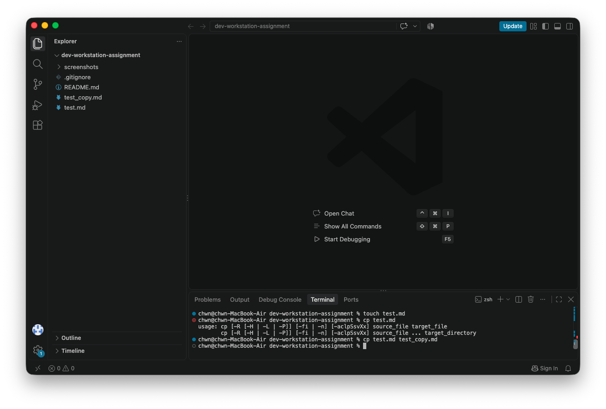

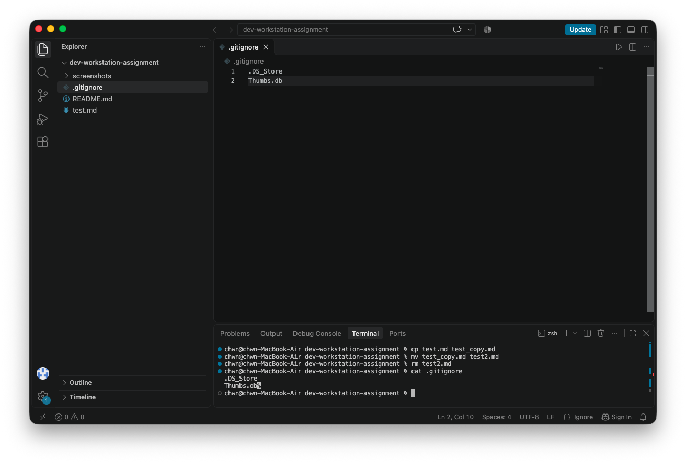

## 5. 권한 실습
- 파일 권한 확인: ls -l
- chmod 실습:
	- 파일 권한 변경: chmod 644 text.txt
		- 권한 변경 목적: 소유자만 수정할 수 있게 하고, 그룹과 기타 사용자는 읽기만 가능하게 하도록 하기 위함 
	- 디렉토리 권한 변경: chmod 755 test-folder
		- 권한 변경 목적: 소유자는 모든 권한을 갖고, 다른 사용자는 폴더 안으로 들어가 내용을 볼 수 있게 하기 위함
	
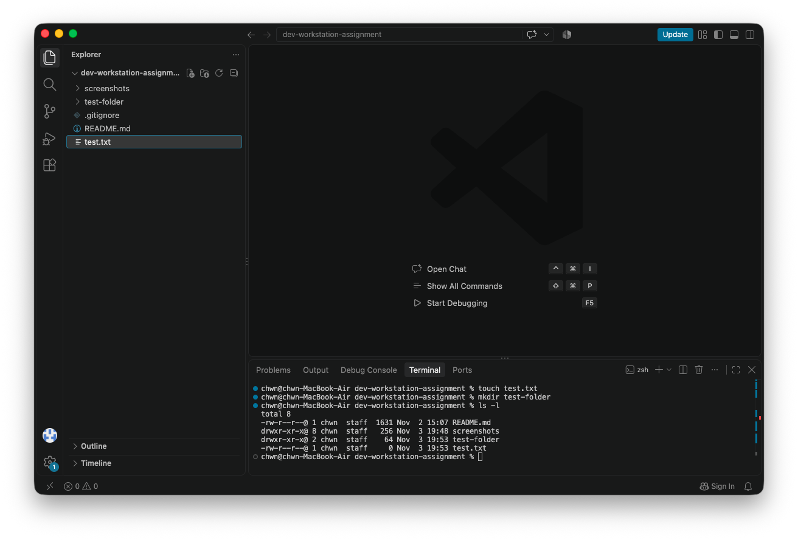
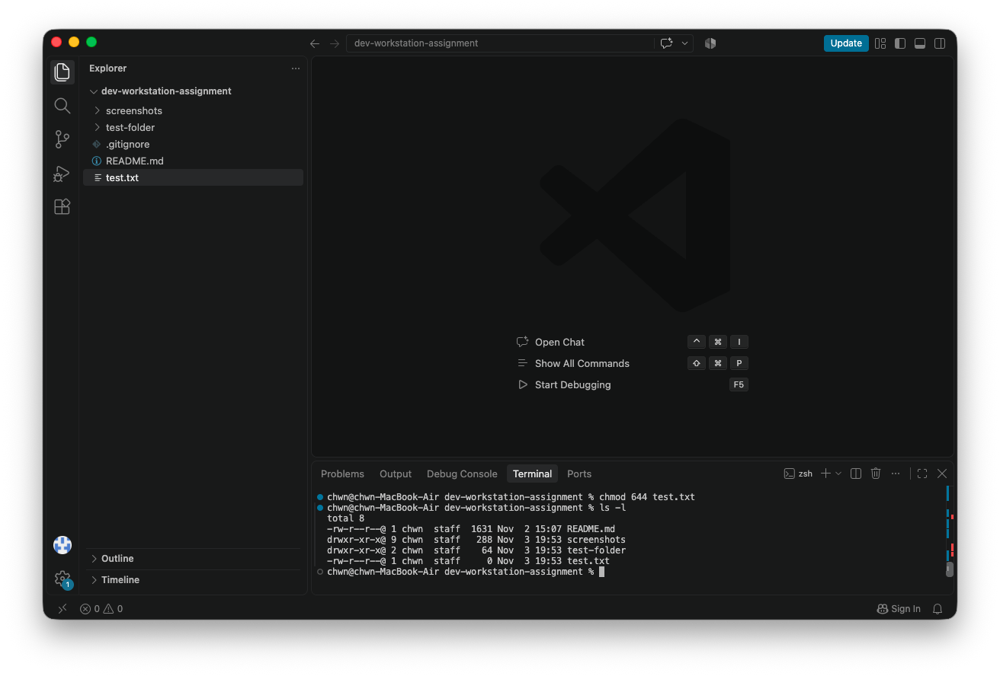
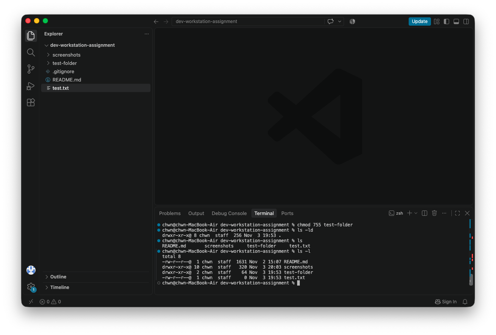

## 6. Docker 기본 실습
- 버전 확인: docker --version
	- 결과: Docker version 29.9.2, build a82e528 (정상 설치 확인)
- 상태 정보 확인: docker info
	- 결과 요약: Server 정보가 정상 출력됨. Docker 데몬(daemon)이 실행 중이며 클라이언트와 정상 통신하는 것을 확인함
	- 핵심 항목: Server Version 29.9.2, containers 6개(running 0 / stopped 6), images 4개. 데몬 정상 실행 중
- 이미지 다운로드 및 확인:
	- 이미지 다운로드: docker pull nginx
	- 이미지 목록 보기: docker images
		- 출력 결과: 
		i Info →   U  In Use
		IMAGE                  ID             DISK USAGE   CONTENT SIZE   EXTRA
		hello-world:latest     c567b231f656       22.6kB         10.3kB    U   
		my-nginx-page:latest   1040d2b35bcc        259MB         62.2MB        
		nginx:latest           5ab5b0b01097        261MB         65.1MB    U   
		ubuntu:latest          6a06111c3b0a        181MB         44.9MB    U  
	- 실행: docker run -d --name nginx-practice -p 8080:80 nginx
	- 상태 확인: docker ps, docker ps -a
		docker ps는 실행 중인 컨테이너(nginx-practice, STATUS: Up)만, docker ps -a는 중지된 컨테이너까지 전체 목록을 보여줌
		- 출력 결과: 
		CONTAINER ID   IMAGE         COMMAND                  CREATED        STATUS                      PORTS     NAMES
		9a0f1d8b1847   nginx         "/docker-entrypoint.…"   19 hours ago   Exited (0) 18 hours ago               web-volume-test2
		dcb6f19597d4   nginx         "/docker-entrypoint.…"   21 hours ago   Exited (0) 20 hours ago               stats-practice
		d816c31854b5   ubuntu        "/bin/bash"              24 hours ago   Exited (137) 24 hours ago             ubuntu-session
		46d816b5b6d3   ubuntu        "/bin/bash"              24 hours ago   Exited (0) 24 hours ago               ubuntu-practice
		d458dc4156f1   nginx         "/docker-entrypoint.…"   25 hours ago   Exited (0) 24 hours ago               nginx-practice
		db3bfe1bde81   hello-world   "/hello"                 25 hours ago   Exited (0) 25 hours ago               blissful_keller
	- 로그 확인: docker logs nginx-practice
	- 리소스 확인: docker stats nginx-practice
	- 중지:docker stop nginx-practice
	

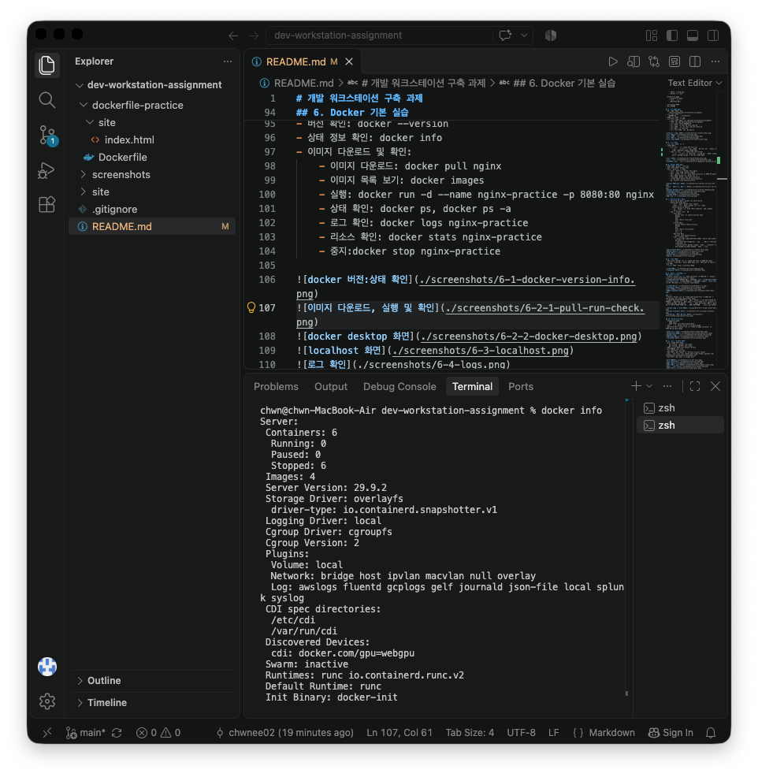

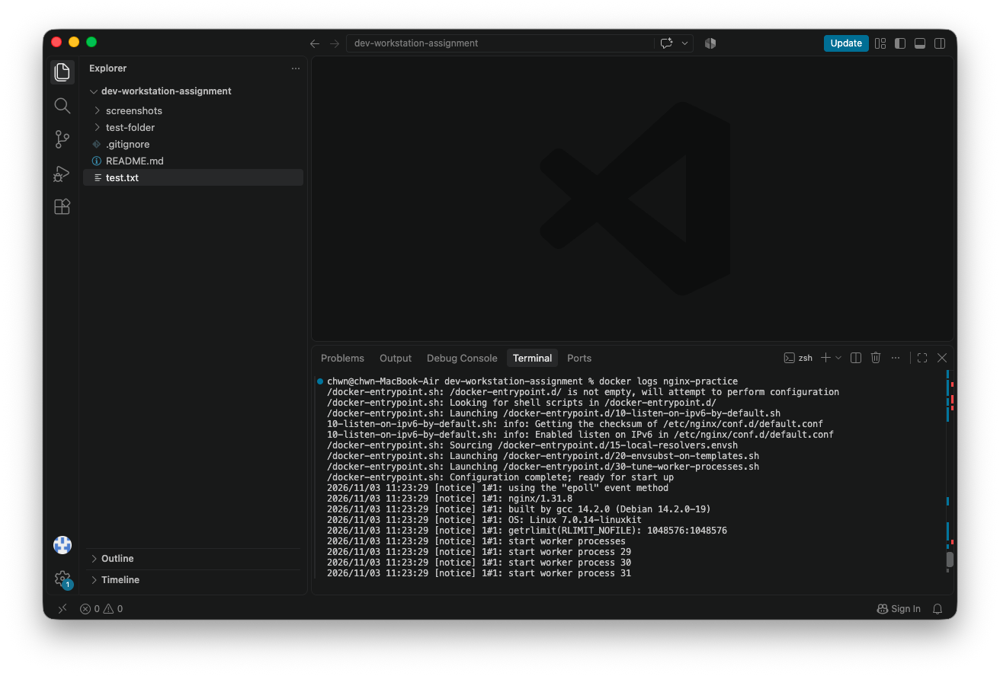
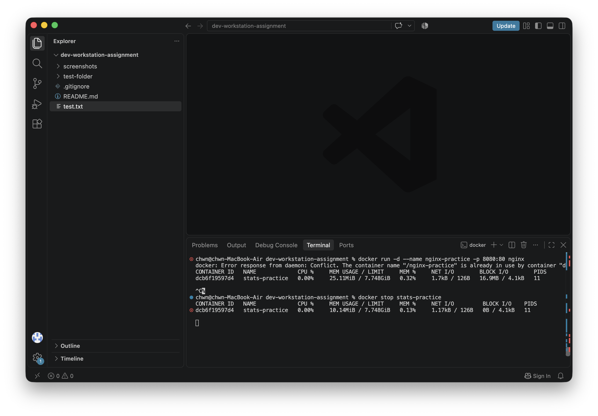

	
## 7. 컨테이너 실행 실습:
	- hello-world 실행: docker run hello-world	
		- 출력 핵심 문장: "Hello from Docker!" / "This message shows that your installation appears to be working correctly."
		- 결과 요약: 로컬에 hello-world 이미지가 없어 Docker Hub에서 받아온 뒤 컨테이너를 실행했고, 위 문장이 출력되어 Docker 설치와 실행이 정상임을 확인함
	- ubuntu 컨테이너 실행: 
		- 이미지 다운: docker pull ubuntu
		- 실행 및 내부 진입: docker run -it --name ubuntu-practice ubuntu
		- 내부 명령어: ls, echo "Hello Ubuntu", pwd, whoami
		- 종료: exit
	- exec / attach 차이 관찰:
		- exec 실습:
			docker exec -it ubuntu-session bash
			whoami
			pwd
			echo "Hello from exec"
			exit
		- attach 실습:
			docker attach ubuntu-session
			whoami
			pwd
			echo "Hello from attach"
			Ctrl + P
			Ctrl + Q
		- 컨테이너 종료
			docker stop ubuntu-session
		- exec / attach 차이
			- exec는 실행 중인 컨테이너 안에서 새로운 프로세스를 추가로 실행하는 것
			- attach는 컨테이너가 처음 시작될 때 실행한 메인 프로세스에 연결(접속)하는 것
			- exec는 새로운 작업을 시작하고 싶을 때, attach는 메인 프로세스의 입출력을 확인하고 싶을 때 사용

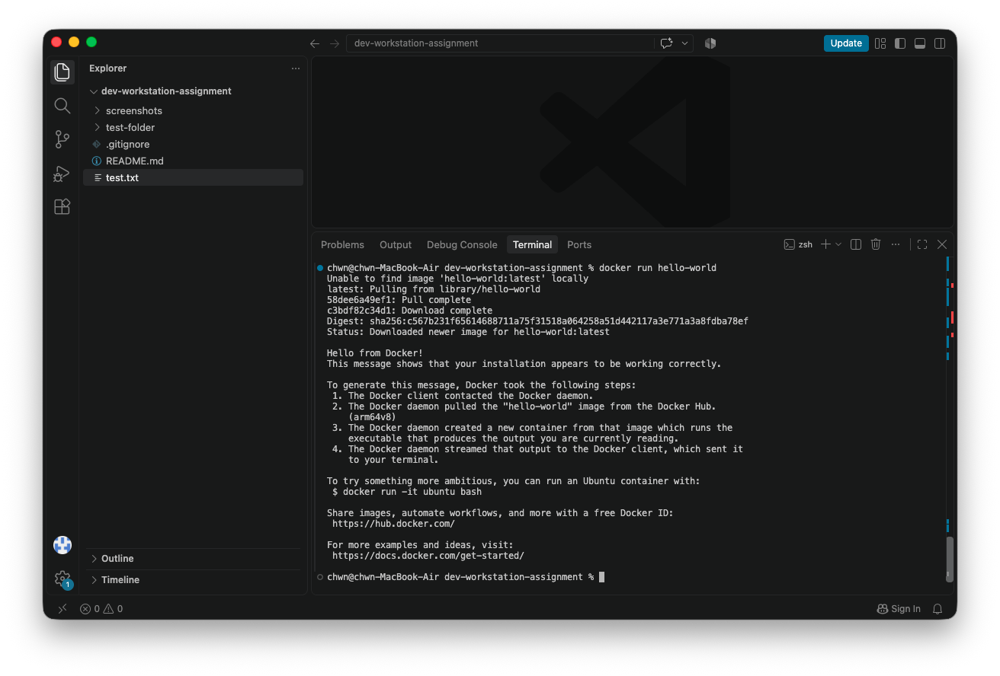
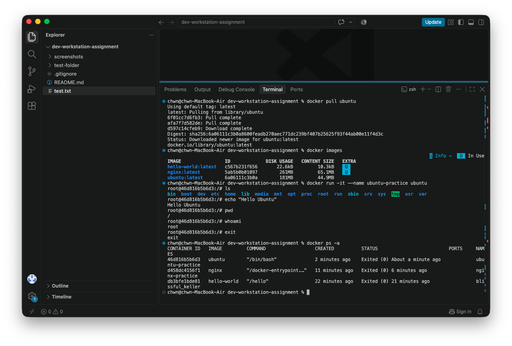

## 추가 설명
- 이미지와 컨테이너의 차이(빌드/실행/변경 관점)
	- 이미지는 컨테이너를 만들기 위한 읽기 전용 템플릿(설계도)이고, 컨테이너는 이미지를 실행한 결과물이다. 이미지로 컨테이너 여러 개 만들 수 있다.
- 빌드
	- 이미지: pull은 docker hub에서 이미 만들어진 설계도를 가져오는 것, build는 dockerfile을 읽고 직접 만드는 명령어이다.
	- 컨테이너: 이미지에서 docker run 명령어로 생성이 가능하다. 이미지가 있어야만 컨테이너 생성이 가능하다.
- 실행
	- 이미지는 실행되는 게 아니라 저장된 설계도라서 실행/중지 상태가 없다.
	- 컨테이너는 실제로 돌아가는 프로세스라서 상태가 존재하며, 실행 중에는 up, 멈춘 후에는 exited로 확인 가능하다
- 변경
	- 이미지는 만들어진 후 수정이 불가하다. 내용을 바꾸고 싶으면 dockerfile 수정을 통해 재build 과정이 필요하다.
	- 컨테이너는 실행 중 파일을 바꿀 수 있다. 그러나 그 변경은 해당 컨테이너 안에만 있어서 컨테이너 삭제 시 함께 사라진다. 해당 컨테이너를 생성한 이미지의 내용은 수정되지 않는다.
	- 그래서 볼륨을 이용하면 컨테이너를 지워도 기록이 남을 수 있다.
- 생애주기
	- 이미지: dockerfile 작성 -> docker build -> 이미지 생성 -> docker rmi
	- 컨테이너: docker run -> 실행 상태(up) -> 작업(exec, attach, logs) -> docker stop -> docker rm

## 8. 포트 매핑
- 실행 명령: docker run -d --name web-test -p 8080:80 nginx
- 브라우저 접속 결과: nginx 기본 환영 페이지(Welcome to nginx!) 정상 출력 확인
- 주소창 확인: http://localhost:8080 
- curl 확인: curl -I http://localhost:8080
	HTTP/1.1 200 OK
	Server: nginx/1.31.8
	Date: Wed, 04 Nov 2026 12:14:55 GMT
	Content-Type: text/html
	Content-Length: 896
	Last-Modified: Wed, 21 Oct 2026 14:24:51 GMT
	Connection: keep-alive
	ETag: "6ad8cb33-380"
	Accept-Ranges: bytes

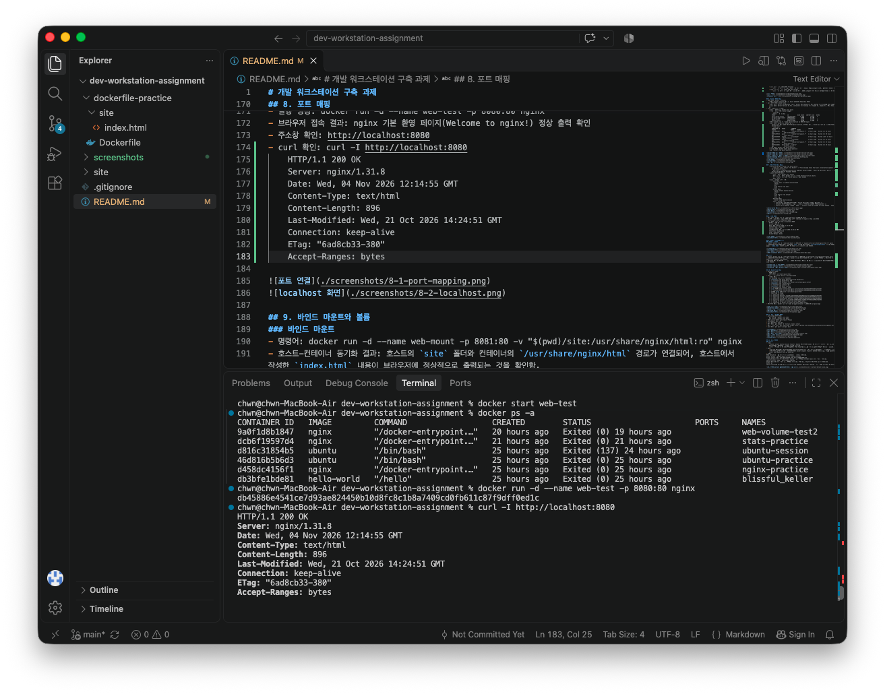

## 추가 설명
- 네트워크 네임스페이스: 컨테이너마다 네트워크 공간을 따로 나눠주는 기능. 컨테이너는 이 기능으로 자기만의 네트워크 환경을 가질 수 있다. 
- 포트 포워딩:
	- -p 8080:80은 호스트의 8080 포트로 들어온 요청을 컨테이너의 80 포트로 전달
	- 동작 흐름: 브라우저가 localhost:8080으로 요청 전송 -> docker가 호스트의 8080 포트에서 요청 수락 -> docker가 요청을 컨테이너 내부의 80 포트로 전달 -> 컨테이너 안의 nginx 응답, 응답이 브라우저에 표시됨 (맥의 경우 리눅스 가상머신(vm)을 만들어 실행하기 때문에 docker가 포트를 vm으로 전달 이라고 이해해야 함)

- 포트 충돌: 호스트의 포트 하나는 한 번에 하나의 프로그램만 사용할 수 있다. 같은 호스트 포트를 두 컨테이너에 매핑 시 충돌이 발생한다.
	- 같은 포트로 컨테이너 두 개 실행: 두 번째 실행에서 포트가 이미 사용 중이라는 에러 발생
	- 해결 방안: 
		1. 포트를 사용 중인 프로세스 확인: lsof -i :8080
		2. 어떤 컨테이너가 사용 중인지 확인: docker ps
		3. 포트 해제: docker stop port-a
		4. 정리 및 해제 확인: docker rm -f port-a port-b, lsof -i :8080

## 9. 바인드 마운트와 볼륨
### 바인드 마운트
- 명령어: docker run -d --name web-mount -p 8081:80 -v "$(pwd)/site:/usr/share/nginx/html:ro" nginx
- 호스트-컨테이너 동기화 결과: 호스트의 `site` 폴더와 컨테이너의 `/usr/share/nginx/html` 경로가 연결되어, 호스트에서 작성한 `index.html` 내용이 브라우저에 정상적으로 출력되는 것을 확인함.

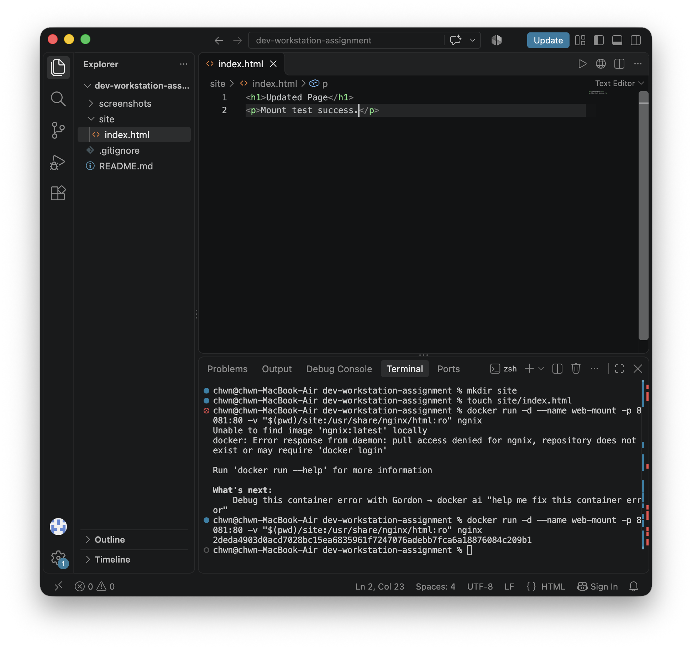
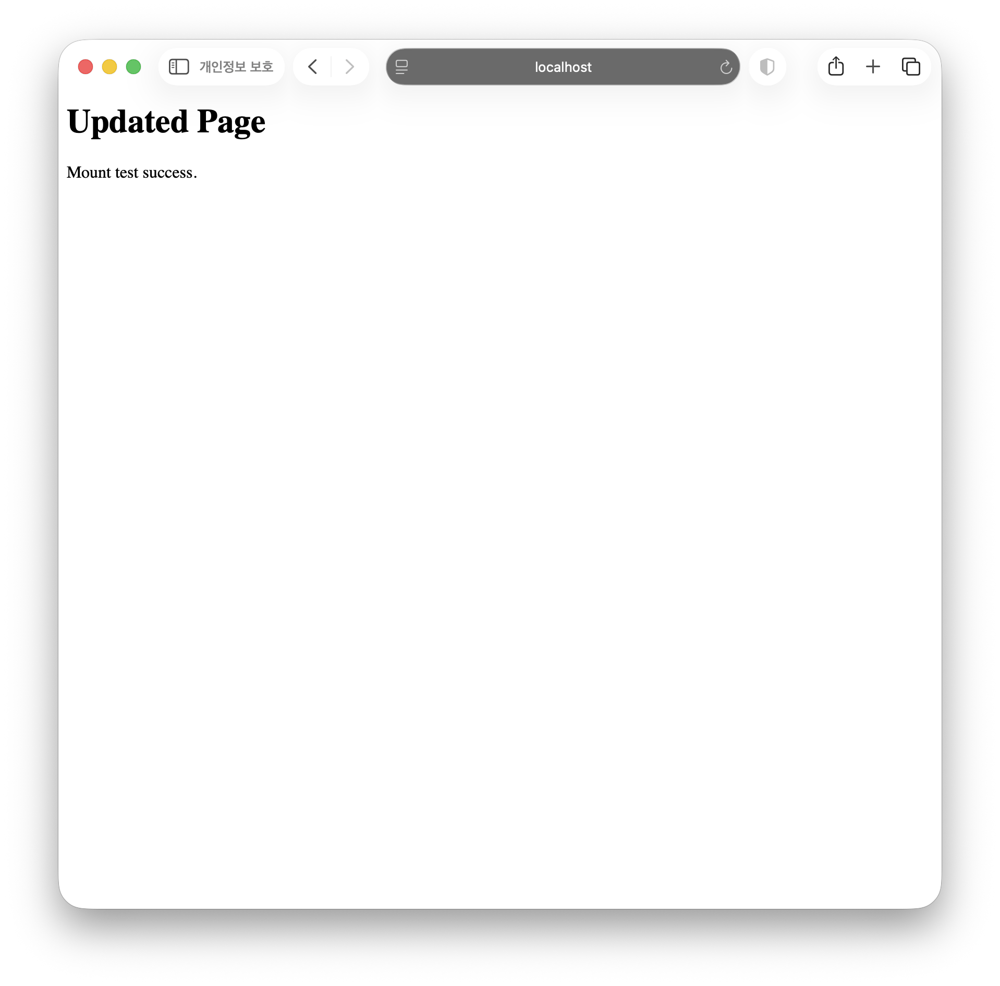

### 볼륨
- 명령어: docker run -d --name web-volume-test -p 8082:80 -v web-volume:/usr/share/nginx/html nginx
- 볼륨 이름: web-volume
- 볼륨 목록 확인: docker volume ls
	- 출력 결과: 
	DRIVER    VOLUME NAME
	local     web-volume
- 볼륨 상세 확인: docker volume inspect web-volume
	- 출력 결과: 
	[
		{
			"CreatedAt": "2026-11-03T16:28:47Z",
			"Driver": "local",
			"Labels": null,
			"Mountpoint": "/var/lib/docker/volumes/web-volume/_data",
			"Name": "web-volume",
			"Options": null,
			"Scope": "local"
		}
	]
- 호스트-컨테이너 데이터 공유 결과: Docker 볼륨을 컨테이너의 웹 페이지 경로에 연결하고, 컨테이너 내부에서 작성한 파일이 정상적으로 출력되는 것을 확인함.
- 컨테이너 삭제 후 데이터 유지 여부: 기존 컨테이너를 삭제한 후 동일한 볼륨을 새로운 컨테이너에 연결했을 때 기존 데이터가 유지되는 것을 확인함.

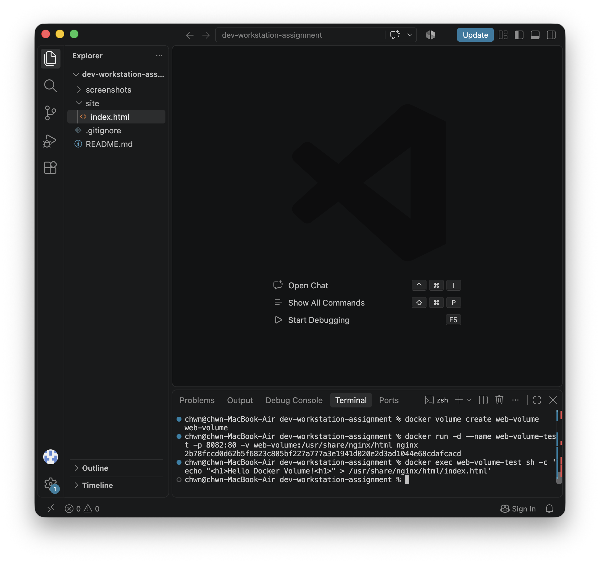
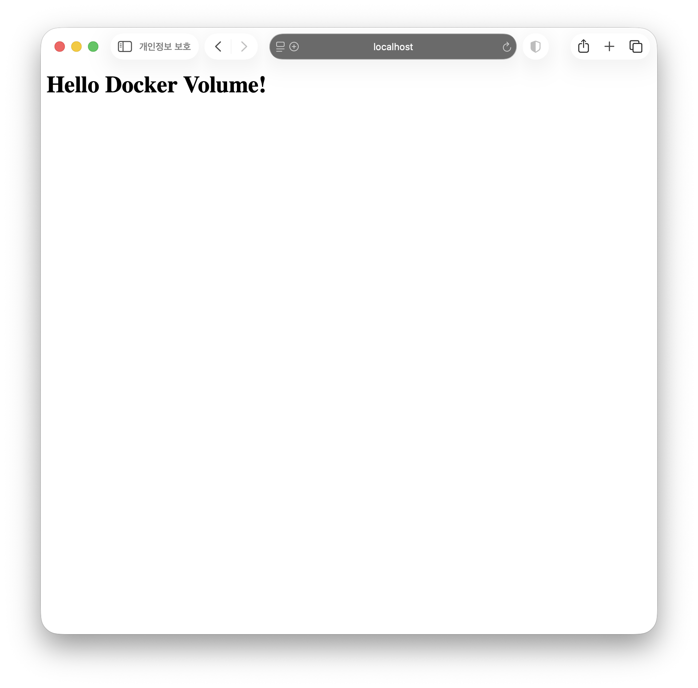
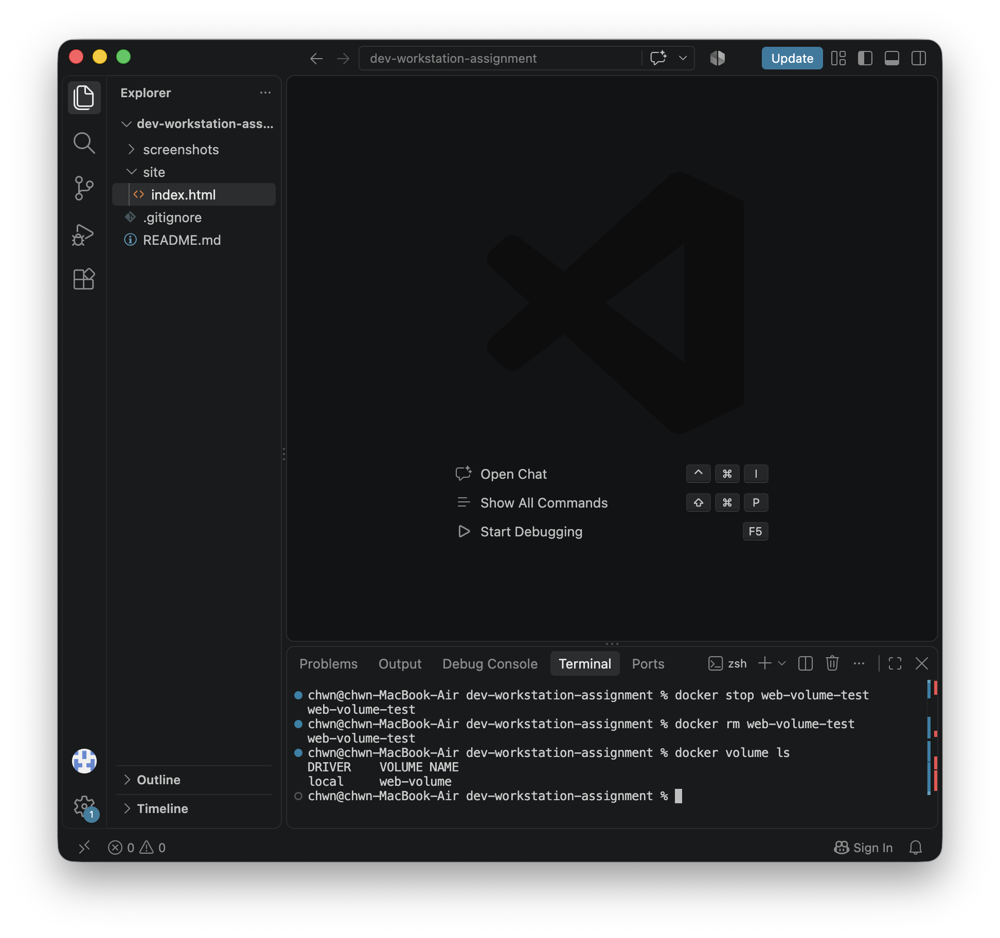
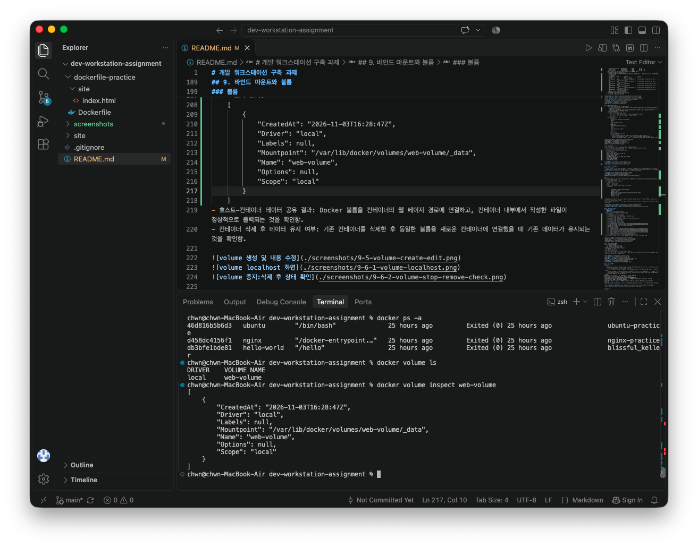

## 추가 설명
- 백업 전략: 
	- 볼륨 내용을 tar 파일로 백업: 임시 컨테이너를 하나 띄워서 볼륨 내용을 내 폴더에 압축 파일로 저장
	- 명령어:
	mkdir -p backup
	docker run --rm -v web-volume:/data -v "$(pwd)/backup:/backup" ubuntu tar czf /backup/web-volume-backup.tar.gz -C /data .

## 10. Dockerfile 실습
- Dockerfile 작성: 
	FROM nginx
	COPY site/ /usr/share/nginx/html/
- 이미지 빌드: docker build -t my-nginx-page .
	- 실행 결과:
	[+] Building 0.1s (7/7) FINISHED
	=> [internal] load build definition from Dockerfile
	=> => transferring dockerfile: 81B
	=> [internal] load metadata for docker.io/library/nginx:latest
	=> [internal] load .dockerignore
	=> => transferring context: 2B
	=> [internal] load build context
	=> => transferring context: 137B
	=> [1/2] FROM docker.io/library/nginx:latest@sha256:5ab5b0b01097420873a3f3330f
	=> => resolve docker.io/library/nginx:latest@sha256:5ab5b0b01097420873a3f3330f
	=> CACHED [2/2] COPY site/ /usr/share/nginx/html/
	=> exporting to image
	=> => exporting layers
	=> => exporting manifest sha256:413917b4516c35d4a9e5a72ac72c2abf69aa7314bf7a92
	=> => exporting config sha256:ab94b7c322d138e4a8ba9316d4e13cd8fd48b928ec3d2b1a
	=> => exporting attestation manifest sha256:27929f28fb9e1bbd71f87de812d250d82d
	=> => exporting manifest list sha256:1040d2b35bcc76e09ec7876f8812e89081fbd4296
	=> => naming to docker.io/library/my-nginx-page:latest
	=> => unpacking to docker.io/library/my-nginx-page:latest
- 컨테이너 실행: docker run -d --name my-page-container -p 8083:80 my-nginx-page

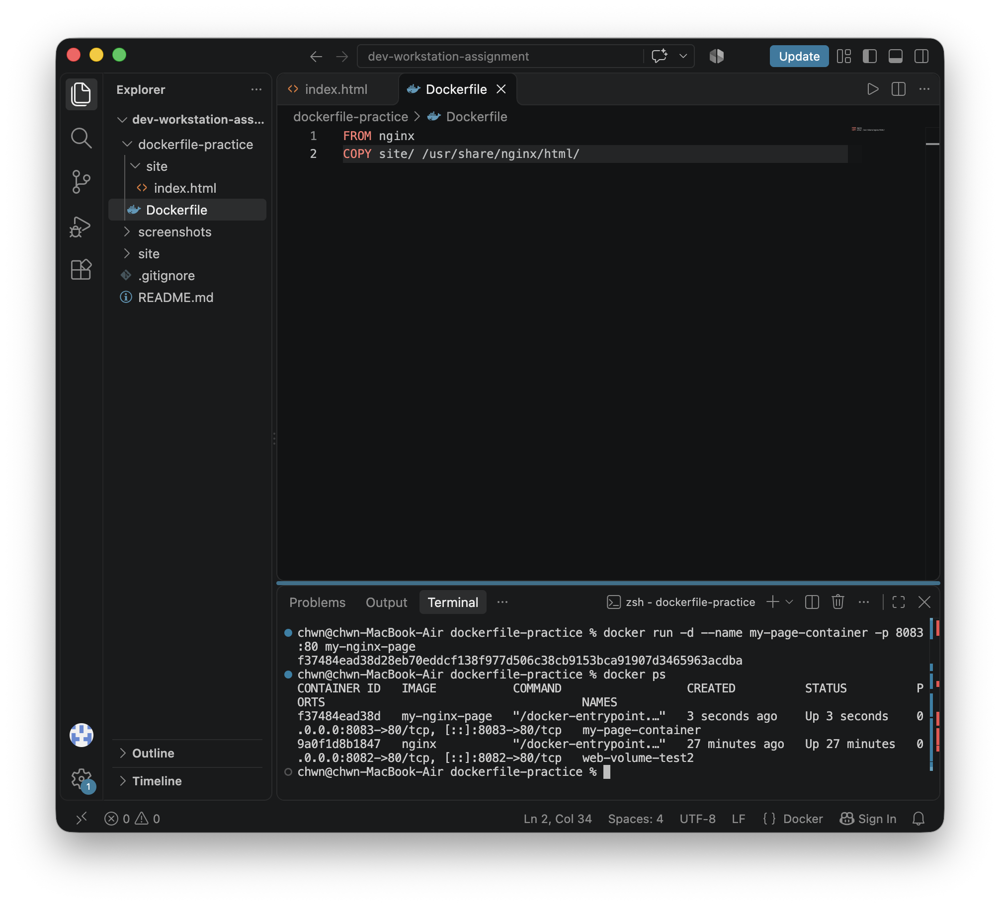

## 재현 체크리스트
1. 준비
- [ ] Docker Desktop 실행 (데몬이 켜져 있어야 함)
- [ ] `docker --version` → 버전 출력 확인 
- [ ] `docker info` → Server 정보가 출력되는지 확인

2. 포트 매핑 (8번)
- [ ] `docker run -d --name web-test -p 8080:80 nginx`
- [ ] `docker ps` → web-test의 STATUS가 Up인지 확인
- [ ] 브라우저에서 `http://localhost:8080` 접속 → "Welcome to nginx!" 확인
- [ ] `curl -I http://localhost:8080` → `HTTP/1.1 200 OK`, `Server: nginx/1.31.8` 확인 
- [ ] `docker stop web-test`

3. 바인드 마운트 (9번)
- [ ] 프로젝트 폴더에 `site/index.html` 작성
- [ ] `docker run -d --name web-mount -p 8081:80 -v "$(pwd)/site:/usr/share/nginx/html:ro" nginx` 
- [ ] `http://localhost:8081` 접속 → index.html 내용 확인 
- [ ] 호스트에서 `site/index.html` 수정 
- [ ] 브라우저 새로고침 → 수정 내용 반영 확인 
- [ ] `docker stop web-mount`

4. 볼륨 (9번)
- [ ] `docker run -d --name web-volume-test -p 8082:80 -v web-volume:/usr/share/nginx/html nginx`
- [ ] 컨테이너 안에서 웹 페이지 파일 내용 수정 
- [ ] `http://localhost:8082` 접속 → 수정한 내용 확인
- [ ] `docker volume ls` → `web-volume` 확인
- [ ] `docker volume inspect web-volume` → Driver `local`, Mountpoint `/var/lib/docker/volumes/web-volume/_data` 확인
- [ ] 컨테이너 중지·삭제: `docker stop web-volume-test`, `docker rm web-volume-test`
- [ ] 같은 볼륨 `web-volume`을 연결한 새 컨테이너 실행 → 기존 데이터가 그대로 있는지 확인

5. Dockerfile (10번)
- [ ] `site/index.html`과 `Dockerfile` 작성 (`FROM nginx` / `COPY site/ /usr/share/nginx/html/`)
- [ ] `docker build -t my-nginx-page .` → 빌드 성공 확인
- [ ] `docker run -d --name my-page-container -p 8083:80 my-nginx-page`
- [ ] `http://localhost:8083` 접속 → 내가 만든 페이지 확인

6. 정리
- [ ] `docker ps -a` → 남은 컨테이너 확인
- [ ] 필요 없는 컨테이너는 `docker rm 컨테이너이름`으로 삭제
- [ ] 볼륨은 데이터 유지 확인이 끝난 뒤에만 `docker volume rm web-volume`

## 11. Git / GitHub 연동
- git 사용자 정보 확인:
	git config --global user.name
	git config --global user.email
- 기본 브랜치 설정: git branch -M main
- git 초기화: git init
- 파일 스테이징: git add .
- 커밋 실행: git commit -m "Initial project setup"
- 원격 저장소 등록: git remote add origin https://github.com/chwnee02/dev-workstation-assignment.git
- push 실행: git push -u origin main
- 커밋 이력 확인: git log --oneline
	- 출력 결과: 
	2bd0066 (HEAD -> main, origin/main) update
	60b7aa4 updates
	0c6a875 update README
	f45449a update README
	9f10652 change README
	3d4495e add screenshots
	f831dbd Merge branch 'main' of https://github.com/chwnee02/dev-workstation-assignment
	6c6c5dd t
	d454638 Initial project setup
	068665e Delete README.md
	5a10708 Delete .gitignore
	cec8dc0 Delete screenshots directory
	5673843 Merge branch 'main' of https://github.com/chwnee02/dev-workstation-assignment
	415a4f8 Add screenshots
	1386871 Delete README.md
	c7ff5ec Initial project setup
	66223e2 Initial commit

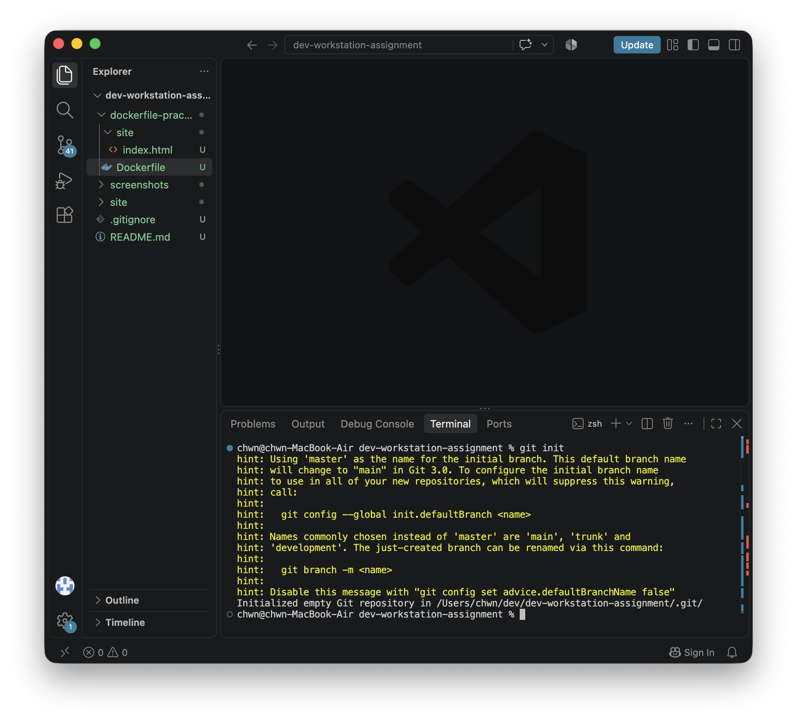
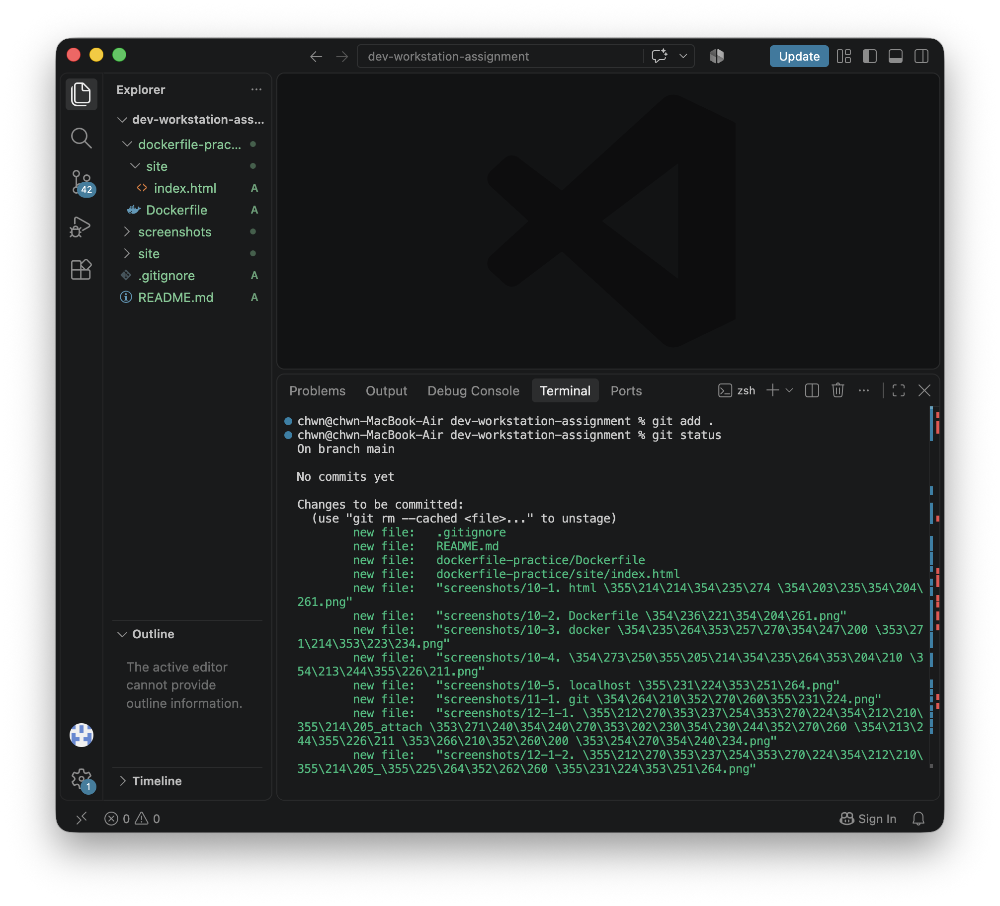

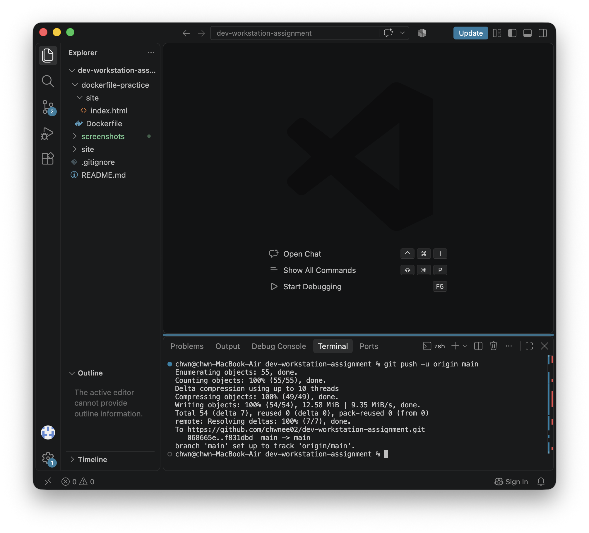

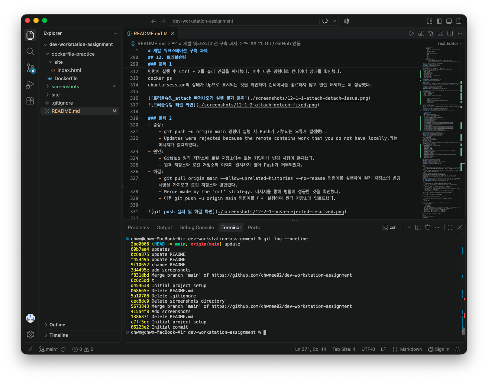

## 12. 트러블슈팅
### 문제 1
- 증상:
	- docker attach ubuntu-session 명령어로 Ubuntu 컨테이너에 접속한 후 Ctrl + P → Ctrl + Q를 눌러도 컨테이너에서 빠져나오지 못하는 문제가 발생했다.
	- Ctrl + P 입력 시 VS Code 터미널에서 이전 명령어가 불러와지는 등 원하는 동작이 실행되지 않았다.
- 원인:
	- VS Code 터미널에서 Docker의 기본 detach 단축키인 Ctrl + P → Ctrl + Q가 의도한 대로 동작하지 않았다.
	- 컨테이너 자체의 문제인지 확인하기 위해 docker inspect 명령어로 설정을 확인했으며, Tty와 OpenStdin 값이 모두 true로 정상 설정되어 있음을 확인했다.
- 해결:
	- 기본 detach 키 대신 Ctrl + X를 사용하도록 변경하여 해결했다.
	docker attach --detach-keys="ctrl-x" ubuntu-session
	docker attach: 실행 중인 컨테이너의 메인 프로세스에 연결한다.
	--detach-keys="ctrl-x": 컨테이너를 종료하지 않고 연결을 해제하는 키를 Ctrl + X로 지정한다.
	ubuntu-session: 연결할 컨테이너의 이름이다.
	명령어 실행 후 Ctrl + X를 눌러 연결을 해제했다. 이후 다음 명령어로 컨테이너 상태를 확인했다.
	docker ps
	ubuntu-session의 상태가 Up으로 표시되는 것을 확인하여 컨테이너를 종료하지 않고 연결 해제하는 데 성공했다.

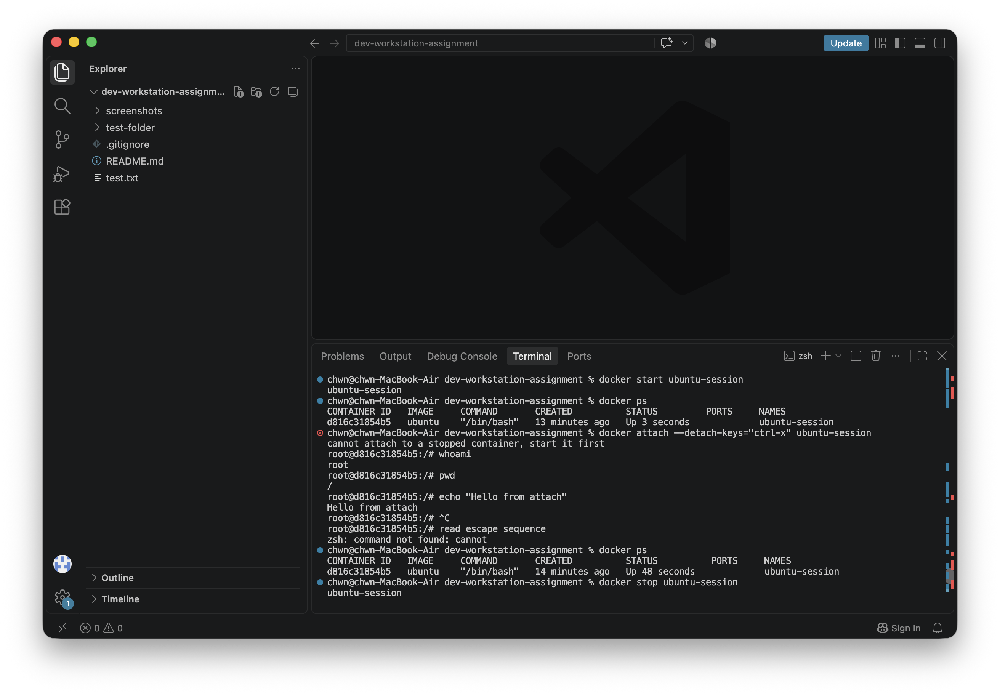

### 문제 2
- 증상:
	- git push -u origin main 명령어 실행 시 Push가 거부되는 오류가 발생했다.
	- Updates were rejected because the remote contains work that you do not have locally.라는 메시지가 출력되었다.
- 원인:
	- GitHub 원격 저장소에 로컬 저장소에는 없는 커밋이나 변경 사항이 존재했다.
	- 원격 저장소와 로컬 저장소의 이력이 일치하지 않아 Push가 거부되었다.
- 해결:
	- git pull origin main --allow-unrelated-histories --no-rebase 명령어를 실행하여 원격 저장소의 변경 사항을 가져오고 로컬 저장소와 병합했다.
	- Merge made by the 'ort' strategy. 메시지를 통해 병합이 성공한 것을 확인했다.
	- 이후 git push -u origin main 명령어를 다시 실행하여 원격 저장소에 업로드했다.
- 검증 (조치 전후 상태 비교):
	- 조치 전: docker ps 로 ubuntu-session이 Up 상태인 것을 확인한 뒤 attach함. 기본 detach 키(Ctrl + P, Ctrl + Q)가 동작하지 않아 빠져나오지 못함
	- 조치 후: --detach-keys="ctrl-x" 로 attach한 뒤 Ctrl + X로 빠져나옴. docker ps 에서 ubuntu-session이 계속 Up 상태인 것을 확인함
	- 출력 결과:
	docker start ubuntu-session
		ubuntu-session
	docker ps
		CONTAINER ID   IMAGE     COMMAND       CREATED        STATUS         PORTS     NAMES
		d816c31854b5   ubuntu    "/bin/bash"   26 hours ago   Up 4 seconds             ubuntu-session
	docker attach --detach-keys="ctrl-x" ubuntu-session
		root@d816c31854b5:/# pwd
		/
		root@d816c31854b5:/# read escape sequence
	docker ps
		CONTAINER ID   IMAGE     COMMAND       CREATED        STATUS          PORTS     NAMES
		d816c31854b5   ubuntu    "/bin/bash"   26 hours ago   Up 48 seconds             ubuntu-session

## 13. 과제 목표 설명
Q1. 절대 경로와 상대 경로의 차이를 예시를 들어 설명
A1.
- 절대 경로는 파일이나 폴더의 위치를 최상위 폴더부터 표현하는 것
ex) /Users/chwn/dev/workstation/site/index.html
- 상대 경로는 현재 내가 위치한 폴더를 기준으로 파일이나 폴더의 위치를 표현하는 것
ex) pwd
workstation
=> site/index.html
- 이번 실습에서 호스트의 일반 명령은 상대경로를, 바운드 마운트 실습 시에는 절대 경로가 필요하여 '$(pwd)'를 사용했다.
- 컨테이너 안 경로는 이미지가 정한 고정 위치라 절대 경로를 사용했다.
- 재현성 고려사항: 상대 경로와 '$(pwd)'를 사용해서 다른 사람이 보아도 같은 명령어로 같은 결과를 얻을 수 있게 하였다.

Q2. 파일 권한의 의미(r/w/x와 755, 644 같은 표기가 어떤 규칙으로 해석되는지 설명)
A2. 
- 파일 권한 r/w/x의 의미
	- r: read 읽기
	- w: write 쓰기
	- x: execute 실행
	- 숫자 표기의 의미
	각 권한마다 정해진 숫자가 있다. r: 4, w: 2, x:1처럼 정해진 숫자가 있고, 필요한 숫자를 더해서 권한을 표현한다.
	ex) rwx = 4+2+1 = 7, rw- = 4+2 =6 
	755, 644 같은 숫자 세 자리는 각각 사용자가 실행할 수 있는 권한의 종류를 의미
	755의 경우 7 = 소유자(rwx), 5 = 그룹(r-x) 5 = 기타사용자(r-x)
	644의 경우 6 = 소유자(rw-), 4 = 그룹(r--), 4 = 기타사용자(r--)
	700의 경우 7 = 소유자(rwx), 0 = 그룹(---), 0 = 기타사용자(---)

Q3. 기존 Dockerfile을 기반으로 "커스텀이미지"를 만들 수 있다
A3. O
작업할 폴더와 파일을 만든 후 html 파일 내용 작성
Dockerfile 내용 작성 
=>
FROM nginx
COPY site/ /usr/share/nginx/html/
커스텀 이미지 빌드
컨테이너 실행

Q4. 포트 매핑이 필요한 이유를 설명할 수 있다
A4. 내 컴퓨터에서 docker 컨테이너 안에서 실행 중인 프로그램에 접속할 수 있도록 연결해주기 위함이다.
내 컴퓨터에서는 컨테이너 내부 포트에 직접 접속할 수 없기 때문에 웹 서버에 접속할 수 있게 포트를 연결해주는 것

Q5. Docker 볼륨(영속 데이터)을 설명할 수 있다
A5. docker 볼륨은 따로 파일을 생성하지 않아도 docker가 저장 공간을 만들어주는 방법
컨테이너를 삭제해도 볼륨은 별도로 존재하기 때문에 데이터는 사라지지 않음

Q6. git과 github의 역할 차이(로컬 버전관리 vs 원격 협업 플랫폼)를 설명할 수 있다
git은 내 컴퓨터(로컬)에서 코드의 변경 이력을 관리하는 도구, github는 git으로 관리하는 프로젝트를 온라인에 저장하고 공유하는 플랫폼이다